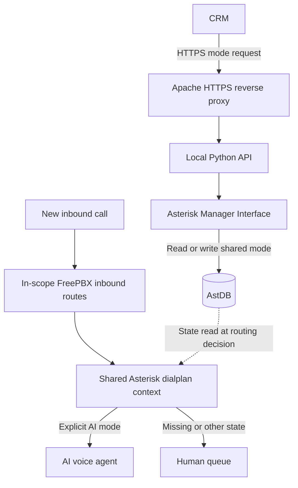

# Dynamic AI/Human Call Routing with FreePBX and Asterisk

## Scope: From One DID to a Shared Queue

The initial design assumed that one inbound number (DID) would switch between
an AI voice agent and a human queue. The requirement instead applied to the
queue: every inbound route in the migrated group needed to follow the same
mode. Putting the decision in one shared dialplan context gave those routes
one policy and one state value to consult, regardless of the dialed number.
The integration was deployed on FreePBX 17 and Asterisk 22 and covered
hundreds of inbound routes.

The integration switches the destination of **new calls** that enter the
shared context. Per-DID switching, multi-agent routing, human takeover of
active calls and spam controls were outside the delivered scope.

## Control Path and Call Path

The CRM requests a state change with a `PUT`. The local API uses AMI `DBGet`
and `DBPut` to read and write the mode in Asterisk's internal database; it does
not write directly to the FreePBX database. The API also provides health,
route inventory and mode readback. For each new call that reaches the shared
context, the dialplan reads the mode and chooses the destination. Only the
explicit `ai` state selects the agent; a missing or non-AI state takes the
human branch. The effective default is the dialplan branch, regardless of
any default shown in API metadata. This is not automatic
failover when the AI destination fails or the control endpoint is unreachable.
A failed update may leave the previous state in effect.

The deployment summary describes HTTPS, an IP allowlist and bearer-token
authentication at the control boundary, with the Python API and AMI confined
to loopback. It also records a dedicated service account and systemd hardening.
The reverse proxy configuration was maintained outside files generated by
FreePBX. This describes reported controls, not an independent security audit.
The diagram is logical and contains no deployed topology or endpoint details.

## Initial Migration vs. Routine Switching

The initial FreePBX change moved the inbound routes in scope from the direct
human destination to a shared custom destination, preserving CRM hooks and
preparing backups and rollback. That configuration change established which
calls could follow the switch and could require applying the FreePBX changes
and reloading. Routine switching changes
the shared AstDB value; it does not edit inbound routes or regenerate the
dialplan on every request. A route that bypasses the context will not follow
the mode change.

## Evidence and Its Limits

| Phase | Evidence | What it establishes |
|---|---|---|
| Deployment | Real inbound calls were reported in both modes: AI mode reached the agent and human mode reached the queue. | End-to-end behavior for the tested calls at deployment time. It does not establish coverage of every inbound route or every failure path. |
| Later read-only review | API, AstDB, the loaded context, inbound destinations, backups and service status were examined. | Control and configuration observations at the time of review. An HTTP success response is not an inbound call test. |
| Unresolved | Repeated HTTP `401` responses on the root path coexisted with HTTP `200` responses on the health endpoint. The request origin was not confirmed. | No confirmed monitoring fault or call impact. |

No live PBX access, control changes or inbound call tests were performed to
prepare this documentation.

## Route Drift, Legacy Service Status and Rollback

The migration inventory and later export were initially in different formats.
The comparison became meaningful after extracting the same DID field from the
TSV and the later export, then comparing each DID's destination against the
migration baseline. Most routes still used the shared context; a small subset
pointed directly to AI and bypassed the switch. The comparison established a
configuration difference. It did not establish why those routes differed,
whether they were intentional exceptions, or whether callers were affected.
Exact counts are omitted.

A legacy service unit reported `inactive`, while process inspection, the
`safe_asterisk` wrapper, CLI access and uptime indicated that Asterisk was running.
The unit status alone was not grounds for a restart or an outage declaration.
The runtime observations established process presence, not end-to-end call
quality. Check the service actually managing the process before acting on a
legacy unit's status.

There are two different recovery actions. Selecting human mode directs new
calls through the human branch **while retaining the shared context**. Reverting
the original migration restores the previously recorded FreePBX destinations
and changes the call path itself. Before any approved configuration rollback,
review the current destinations against the saved baseline and account for
later edits and intentional exceptions. Validate the affected paths with
representative inbound calls after the change. No production rollback commands
or deployed configuration are included.

[Back to Voice Integration Projects](../../README.md)
