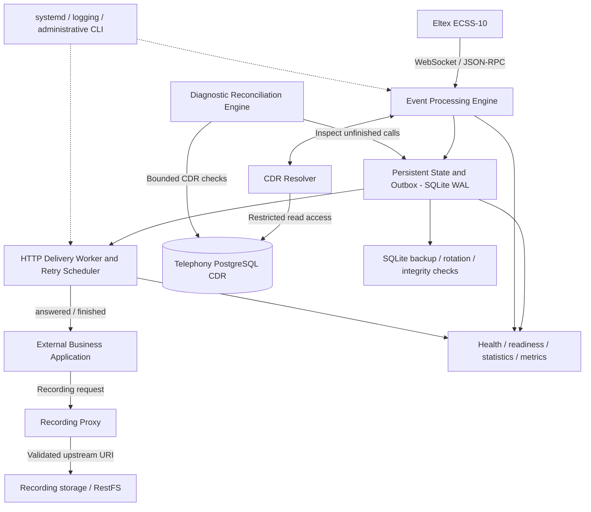

# Eltex Integration Gateway — Telephony Event Integration Service

**Checkpoint:** v0.6.0, deployed on a dedicated Linux VM on November 19, 2026.
**Stage:** Production Pilot / Active Development.
Full production acceptance testing remains pending.

## Business Problem and Engineering Role

An external business application needed to open the customer card when an operator
answered a call, then receive the conversation's completion, duration and recording
link. ECSS-10's technical events had to become coherent business events rather
than a stream of independent connection updates.

I independently researched the interfaces, designed the architecture, implemented,
diagnosed, tested, deployed and documented the integration using AI development
tools. The result is a standalone middleware service, not a claim that I developed
the underlying telephone platform or receiving business application.

## Architecture

The diagram describes functional relationships, not deployment topology or an
executable configuration. Reconciliation inspects evidence; it does not yet
automatically reconstruct and deliver missing events. A recording request is a
separate HTTP path from event delivery.

| Area | Reported implementation |
|---|---|
| Application | Python 3.12, asyncio, aiohttp |
| Telephony interfaces | ECSS-10 Call API / CSTA, WebSocket, JSON-RPC registration, reconnection and support for multiple telephony servers |
| Local persistence | SQLite WAL for call state and delivery queue |
| CDR lookup | PostgreSQL, psycopg2 and a dedicated account with restricted access |
| Recording access | HTTP proxy to recording storage, including GlusterFS / RestFS integration |
| Operations | Ubuntu Server / Linux, systemd, Prometheus-compatible metrics, administrative CLI and backup maintenance |

Support for multiple telephony servers is not evidence of completed failover or HA.
The source does not specify the ECSS build or a detailed compatibility matrix.

## Engineering Decisions and Findings

### One Logical Call, Several Call Legs

**Problem:** treating each technical connection independently could duplicate
business events or finish a call before its other legs had settled.

**Change:** correlate legs under one logical call identifier, persist lifecycle
state, guard against repeated event generation and defer finalization to account
for event sequencing. Cache individual leg parameters because values present in
an initial event can be absent from later updates.

**Result and limit:** the pilot reports delivered `answered` and `finished`
events and CDR correlation. This does not establish complete coverage of complex
transfer, queue or other multi-leg scenarios; broader scenario testing is pending.

### Resolve the Operator's CDR, Not the First Matching Row

**Problem:** several CDRs could belong to one logical call and carry different
durations. The first match was not necessarily the operator's conversation.

**Change:** correlate the logical call identifier with the connection identifier
on which the answer was observed. Resolve that operator leg's actual duration and
original recording URI instead of selecting an arbitrary CDR.

**Result and limit:** CDR correlation and recording retrieval are reported as
checked in the pilot. No universal matching guarantee or unpublished schema is
inferred. The receiving API also rejected a numeric duration; checking its actual
contract and correcting serialization resolved that integration mismatch. The
private payload schema is not reproduced here.

### Persistent Delivery and Ambiguous Outcomes

The delivery worker uses a persistent SQLite outbox, a retry scheduler with
exponential backoff, delivery-order controls and distinct handling of definite
and ambiguous failures. Preview, Live Test and Production modes are reported.

A timeout can leave the sender unable to establish whether the receiving system
accepted an event. The service records an `uncertain` outcome and uses a
conservative strategy instead of uncontrolled resending that could repeat a
business operation. Exact retry policies and external API semantics are not
published. Agreement on receiver idempotency remains pending: neither the local
duplicate-generation guard nor the persistent outbox proves exactly-once processing
or guaranteed end-to-end delivery.

Persistent queue recovery after restart was checked. This is separate from recovery
of telephony events missed while the source connection was unavailable.

### Recording Proxy and HTTP Range Compatibility

Testing exposed an upstream boundary-handling issue for HTTP Range requests.
A compatibility workaround in the Recording Proxy was checked by comparing served
ranges with the original audio file. The proxy serves WAV, supports Range requests,
validates upstream URIs and applies CIDR-based access control.

These are reported pilot checks, not a full HTTP conformance or security audit.
Client-facing recording access and additional transport security remain work items;
no real recording, upstream URI, address or access policy is published.

### Reconnection Does Not Repair a Missing Finish Event

Testing found that a successful WebSocket reconnect did not guarantee receipt of
the finish event for a previously started call. A separate Reconciliation Engine
looks for potentially unfinished local calls, checks connection identifiers against
CDR, assesses recovery eligibility and limits PostgreSQL query load.

Its current result is diagnostic evidence and logging. Automatic restoration of
missing events is still being developed; the engine deliberately avoids premature
automatic recovery. Queue recovery, source reconnection and event reconciliation
are three distinct reliability boundaries.

## Operations and Security Boundaries

The service runs without root under systemd, with restricted process privileges,
filesystem protection, service isolation and restricted socket families.
Configuration and secrets are stored separately. PostgreSQL access is restricted;
IP-based controls and local diagnostic interfaces reduce the exposed surface.

Health, readiness, application statistics and Prometheus-compatible metrics cover
operational visibility, including the delivery queue and potentially unfinished
calls. Centralized logging, graceful shutdown and an administrative CLI support
operation. SQLite backups are automated, rotated and accompanied by integrity
checks. Backup automation is not evidence of a completed disaster-recovery exercise.

In the reported systemd hardening check, the exposure score fell from **8.7 to 3.2**.
This is the result of that specific service assessment, not a general security
rating, penetration test or assurance of production safety.

At the v0.6.0 checkpoint, the main integration process used approximately **24 MB
RAM under light load**. It is an observation, not a load-test result, peak-memory
bound or capacity claim. No throughput or latency benchmark is asserted.

## Reported Pilot Results and Evidence Boundary

The following are supplied results from the project owner's November 19 summary.
They were not independently rerun during this portfolio documentation task.

| Area | Reported result | Boundary |
|---|---|---|
| Telephony | Connected to an operating ECSS-10 platform and received real call events | No exhaustive scenario or failover acceptance |
| Business integration | Delivered `answered` and `finished`; automatic customer-card opening confirmed | Receiver idempotency and complete delivery guarantees not established |
| CDR and audio | Correlation confirmed; audio retrieved through the proxy; served ranges compared with the original | No public recordings, payloads or primary logs; client access remains a next step |
| Lifecycle | Persistent queue recovery and graceful shutdown checked | Does not prove recovery of missed source events or physical host failures |
| Operations | Monitoring implemented and tested; backup automation developed; systemd hardening assessed | No independently repeated monitoring, restore or security audit in this task |
| Deployment | Stable v0.6.0 source checkpoint deployed to a dedicated Linux VM | Production Pilot / Active Development; full acceptance pending |

## Remaining Work

- Observe real operation and complete production acceptance testing.
- Develop automatic recovery of missing events and test complex call scenarios.
- Validate real failover; implement and validate planned Proxmox HA.
- Agree and validate the external API's idempotency behavior.
- Organize client access to recordings and define retention policy.
- Strengthen transport security and prepare a reusable installation package.

No completed HA, automatic reconciliation, exactly-once behavior or load capacity
is claimed. These items remain separate from the reported implemented pilot.

## Publication Scope

This case publishes engineering reasoning and a sanitized logical diagram only.
Service source code, configurations, production logs, customer records, credentials
and call recordings are not included. There is no runnable demo or test dataset in
this update; the diagram is explanatory, not a reproduction of the deployed system.

[Back to Voice Integration Projects](../../README.md)
